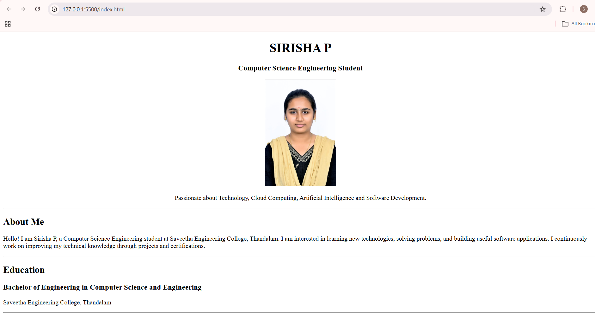
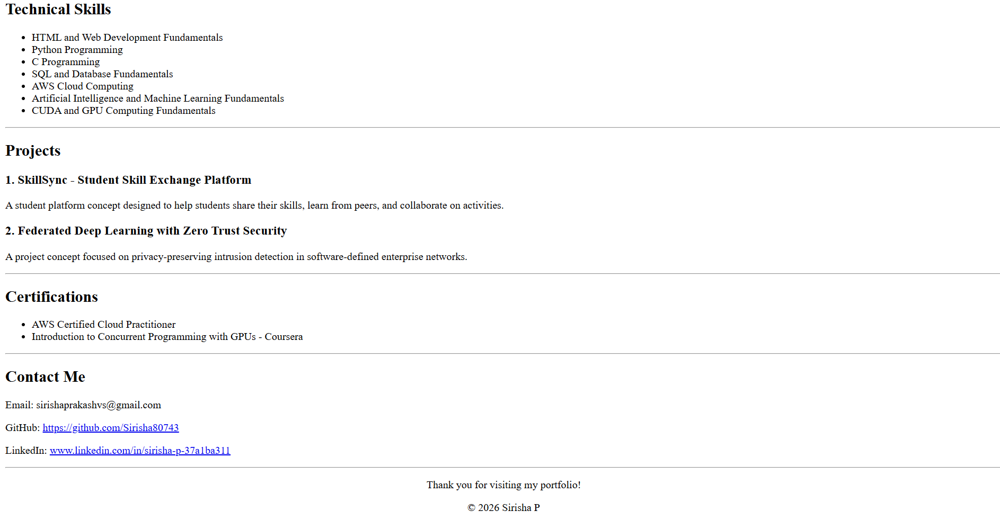

# Ex01 Portfolio
## Date:24-10-2026

## AIM
To create a Portfolio using HTML and CSS.

## ALGORITHM
### STEP 1
Create an HTML file (index.html)

### STEP 2
Create a CSS file (style.css)

### STEP 3
Include a navigation bar with links to different sections.

### STEP 4
Add structured sections for introduction, about, projects, and contact details.

### STEP 5
Define global styles for fonts, colors, and layout.

### STEP 6
Style the header, navigation bar, and sections.

### STEP 7
Use Flexbox or CSS Grid for layout design.

### STEP 8
Add hover effects and transitions for interactivity.

### STEP 9
Add Images and Media.

### STEP 10
Use optimized images for a professional look.

### STEP 11
Open the HTML file in a browser to check layout and functionality.

### STEP 12
Fix styling issues and refine content placement.

### STEP 13
Deploy the Portfolio.

### STEP 14
Upload to GitHub Pages for free hosting.

## PROGRAM
```html

<!DOCTYPE html>
<html lang="en">
<head>
    <meta charset="UTF-8">
    <meta name="viewport" content="width=device-width, initial-scale=1.0">
    <title>Sirisha P - Portfolio</title>
</head>
<body>

    <center>
        <h1>SIRISHA P</h1>
        <h3>Computer Science Engineering Student</h3>

        

        <p>
            Passionate about Technology, Cloud Computing,
            Artificial Intelligence and Software Development.
        </p>

    </center>

    <hr>

    <h2 id="about">About Me</h2>
    <p>
        Hello! I am Sirisha P, a Computer Science Engineering student
        at Saveetha Engineering College, Thandalam. I am interested
        in learning new technologies, solving problems, and building
        useful software applications. I continuously work on improving
        my technical knowledge through projects and certifications.
    </p>

    <hr>

    <h2 id="education">Education</h2>
    <h3>Bachelor of Engineering in Computer Science and Engineering</h3>
    <p>Saveetha Engineering College, Thandalam</p>

    <hr>

    <h2 id="skills">Technical Skills</h2>
    <ul>
        <li>HTML and Web Development Fundamentals</li>
        <li>Python Programming</li>
        <li>C Programming</li>
        <li>SQL and Database Fundamentals</li>
        <li>AWS Cloud Computing</li>
        <li>Artificial Intelligence and Machine Learning Fundamentals</li>
        <li>CUDA and GPU Computing Fundamentals</li>
    </ul>

    <hr>

    <h2 id="projects">Projects</h2>

    <h3>1. SkillSync - Student Skill Exchange Platform</h3>
    <p>
        A student platform concept designed to help students share
        their skills, learn from peers, and collaborate on activities.
    </p>


    <h3>2. Federated Deep Learning with Zero Trust Security</h3>
    <p>
        A project concept focused on privacy-preserving intrusion
        detection in software-defined enterprise networks.
    </p>

    <hr>

    <h2 id="certifications">Certifications</h2>
    <ul>
        <li>AWS Certified Cloud Practitioner</li>
        <li>Introduction to Concurrent Programming with GPUs - Coursera</li>
    </ul>

    <hr>

    <h2 id="contact">Contact Me</h2>
    <p>Email: sirishaprakashvs@gmail.com</p>
    <p>
        GitHub:
        <a href="https://github.com/S">
            https://github.com/Sirisha80743
        </a>
    </p>
    <p>
        LinkedIn:
        <a href="https://www.linkedin.com/">
            www.linkedin.com/in/sirisha-p-37a1ba311
        </a>
    </p>

    <hr>

    <center>
        <p>Thank you for visiting my portfolio!</p>
        <p>&copy; 2026 Sirisha P</p>
    </center>

</body>
</html>
```

## OUTPUT





## RESULT
The program for creating Portfolio using HTML and CSS is executed successfully.
